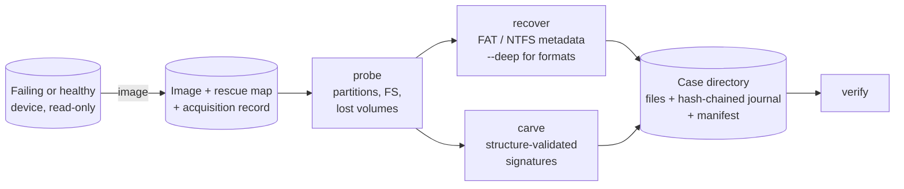

# BareRelic

**General-purpose bare-metal data recovery and forensic reconstruction.**

BareRelic works on the raw bytes of a storage device — below the operating
system's view of files — to get data back after deletion, formatting, lost
partitions and physical media damage. It is a single static binary with no
dependencies outside the Go standard library, and it treats every source as
evidence: nothing is ever written to it, every recovered file is hashed and
traceable to exact byte ranges, and every run leaves a tamper-evident record.

| Situation | How BareRelic gets data back | Command |
|---|---|---|
| Failing / physically damaged disk | ddrescue-style multi-pass imaging: secures healthy areas first, then trims, scrapes and retries bad regions; resumable after power loss or Ctrl-C | `image` |
| Deleted files (FAT12/16/32, NTFS) | reads surviving file-system metadata: `0xE5` directory entries and long names on FAT; unallocated MFT records, runlists and resident data on NTFS | `recover` |
| Files deleted years ago | as above while metadata survives; otherwise content carving of 14 formats validated by their internal structure | `recover`, `carve` |
| Formatted device (quick format) | `--deep` finds orphaned FAT directory clusters and NTFS MFT records left by the previous file system; carving covers the rest | `recover --deep`, `carve` |
| Deleted / corrupted partition table | scans every sector for boot sectors and superblocks **including backup copies** (NTFS backup boot sector, FAT32 sector 6, ext backup superblocks, backup GPT) and infers where each volume started | `probe --scan` |
| No file system at all (raw dumps, unknown FS) | structure-validated carving (JPEG, PNG, GIF, BMP, PDF, ZIP/DOCX/XLSX/PPTX/ODF/EPUB/JAR/APK, GZIP, 7z, SQLite, DOC/XLS/PPT/MSG, WAV/AVI/WebP, MP4/MOV/HEIC/3GP, PE, ELF) | `carve` |

> **Validation boundary.** Every recovery path is exercised by automated tests
> against synthetic media built byte-by-byte from the on-disk specifications
> (FAT12/16/32, NTFS, MBR/EBR, GPT, ext superblocks, 14 file formats), by an
> end-to-end test of the whole CLI workflow, by fault-injection tests of the
> imager (bad, flaky and partial sectors, interruption and resume), and by
> fuzzing of every parser of untrusted input. It has **not yet** been validated
> against a corpus of real-world disk images or real failing hardware, and raw
> device geometry queries are only compile-checked on Linux/macOS/Windows. See
> [limitations](docs/limitations.md) before relying on it for anything that matters.

## How it fits together



1. **Image first.** A failing drive can die at any moment; every read must count.
   `image` copies the device once, fast, skipping around trouble, and only then
   goes back for the hard sectors. The rescue map is GNU ddrescue-compatible.
2. **Analyse the image, never the original.** `probe`, `recover` and `carve`
   accept devices too, but running them against an image is safer and repeatable.
3. **Keep the evidence trail.** Every recovered file is written once (never
   overwritten), hashed while written, and journaled with its source extents,
   method, confidence and notes. `verify` re-checks all of it.

## Install

Requires Go 1.25+ (the build pins Go 1.26.8 via the `toolchain` directive).

```sh
git clone https://github.com/shanurwan/BareRelic.git && cd BareRelic
make build            # -> bin/barerelic   (or: go build ./cmd/barerelic)
make demo             # full workflow against a synthetic evidence disk
```

Raw devices need elevated privileges: `sudo` on Linux/macOS, an elevated
prompt on Windows (`\\.\PhysicalDrive1`, `\\.\E:`).

## Quick start

```sh
# 1. Acquire. Re-run the same command to resume or retry after interruption.
sudo barerelic image --out /mnt/evidence/sdb.img --case 2026-017 --examiner "J. Doe" /dev/sdb

# 2. What is on it? --scan also finds deleted/lost partitions.
barerelic probe --scan /mnt/evidence/sdb.img

# 3. Triage, then recover deleted files (add --all for live files, --deep for formatted volumes).
barerelic recover --dry-run --partition 1 /mnt/evidence/sdb.img
barerelic recover --partition 1 --deep --map /mnt/evidence/sdb.img.map --out cases/2026-017-fs /mnt/evidence/sdb.img

# 4. Carve whatever metadata cannot explain.
barerelic carve --types jpeg,png,pdf,docx --map /mnt/evidence/sdb.img.map --out cases/2026-017-carve /mnt/evidence/sdb.img

# 5. Prove nothing changed since.
barerelic verify cases/2026-017-fs
barerelic verify /mnt/evidence/sdb.img
```

Passing `--map` makes `recover` and `carve` flag (and downgrade to low
confidence) any file whose bytes fall in regions the imager could not read.

## Commands

| Command | Purpose | Key flags |
|---|---|---|
| `image <src>` | resumable rescue imaging | `--out`, `--map`, `--block-size`, `--retries`, `--no-trim`, `--no-scrape`, `--skip-max` |
| `probe <src>` | partition table, file systems, lost volumes | `--scan`, `--json` |
| `recover <src>` | metadata-based recovery (FAT12/16/32, NTFS) | `--out`, `--partition`/`--offset`, `--all`, `--deep`, `--map`, `--dry-run`, `--include-system` |
| `carve <src>` | signature + structure carving | `--out`, `--types`, `--align`, `--offset`/`--length`, `--no-skip`, `--map`, `--list-types` |
| `hash <src>` | MD5, SHA-1, SHA-256 in one pass | `--json` |
| `verify <case-dir \| image>` | re-verify journal chain, manifest pin and artifact hashes, or an image against its acquisition record | |
| `version` | build identity (version, VCS revision, toolchain) | `--json` |

All commands accept `--case`, `--examiner`, `--log-level` and `--log-format json`.
Logs go to stderr; results go to stdout.

**Exit codes:** `0` complete · `1` failed · `2` usage · `3` partial (unreadable
regions, unrecoverable items, or verification problems) · `130` interrupted
after checkpointing. See [operations](docs/operations.md).

## Case directory

```text
cases/2026-017-fs/
├── journal.jsonl   append-only, fsynced, SHA-256 hash-chained events
├── manifest.json   outcome, counts, confidence histogram, pinned journal head
└── files/
    ├── p1/Users/ana/Documents/thesis-final.docx
    └── p2/$OrphanFiles/lost.txt
```

A journal entry for one recovered file:

```json
{"seq":2,"kind":"artifact","prev":"7e310f…","data":{
  "path":"files/p2/payroll.xlsx","size":9000,"sha256":"861d19…",
  "method":"ntfs-mft","state":"deleted","confidence":"high",
  "original_path":"/payroll.xlsx","extents":[{"offset":23248896,"length":9000}],
  "modified":"2014-03-09T18:45:00Z","notes":["MFT record 30 (sequence 2) at source offset 0x150B800"]}}
```

Confidence is explicit: **high** — structure verified and allocation state
consistent; **medium** — an assumption was needed (contiguity after FAT
deletion, a heuristic end-of-file, geometry of a previous file system);
**low** — content is likely partly overwritten or unreadable.

## What cannot be recovered

Honest limits matter more in recovery than anywhere else:

- **Overwritten data is gone.** Deleted space is reused; the longer a device
  stays in use after loss, the less survives.
- **SSDs, SD cards and phones with TRIM/discard** typically return zeros for
  deleted blocks within seconds or minutes. No software can undo that.
- **Encrypted volumes** (BitLocker, LUKS, FileVault/APFS) are identified but
  not decrypted; without the key, the ciphertext is all there is.
- **Fragmented files** are recovered fully through metadata, but carving
  assumes contiguity.
- **Not yet supported:** ext2/3/4, exFAT, APFS, HFS+, Btrfs, XFS metadata
  recovery (these are identified, and their content can be carved), NTFS
  LZNT1-compressed streams, RAID reassembly.

Full list: [docs/limitations.md](docs/limitations.md).

## Documentation

- [Architecture](docs/architecture.md) — packages, data flow, design decisions
- [Forensic principles & threat model](docs/forensic-principles.md)
- [Operations](docs/operations.md) — exit codes, logs, resumability, performance, sizing
- [Limitations & roadmap](docs/limitations.md)
- Runbooks: [failing drive](docs/runbooks/failing-drive.md) ·
  [deleted files](docs/runbooks/deleted-files.md) ·
  [formatted device](docs/runbooks/formatted-device.md) ·
  [lost partitions](docs/runbooks/lost-partitions.md)

## Development

```sh
make check    # gofmt, go vet, go test
make race     # tests under the race detector (needs cgo)
make lint     # staticcheck
make vuln     # govulncheck
make fuzz     # 30 s per parser of untrusted input
make cross    # static binaries for Linux, macOS, Windows + SHA256SUMS
```

See [CONTRIBUTING.md](CONTRIBUTING.md) and [SECURITY.md](SECURITY.md).
