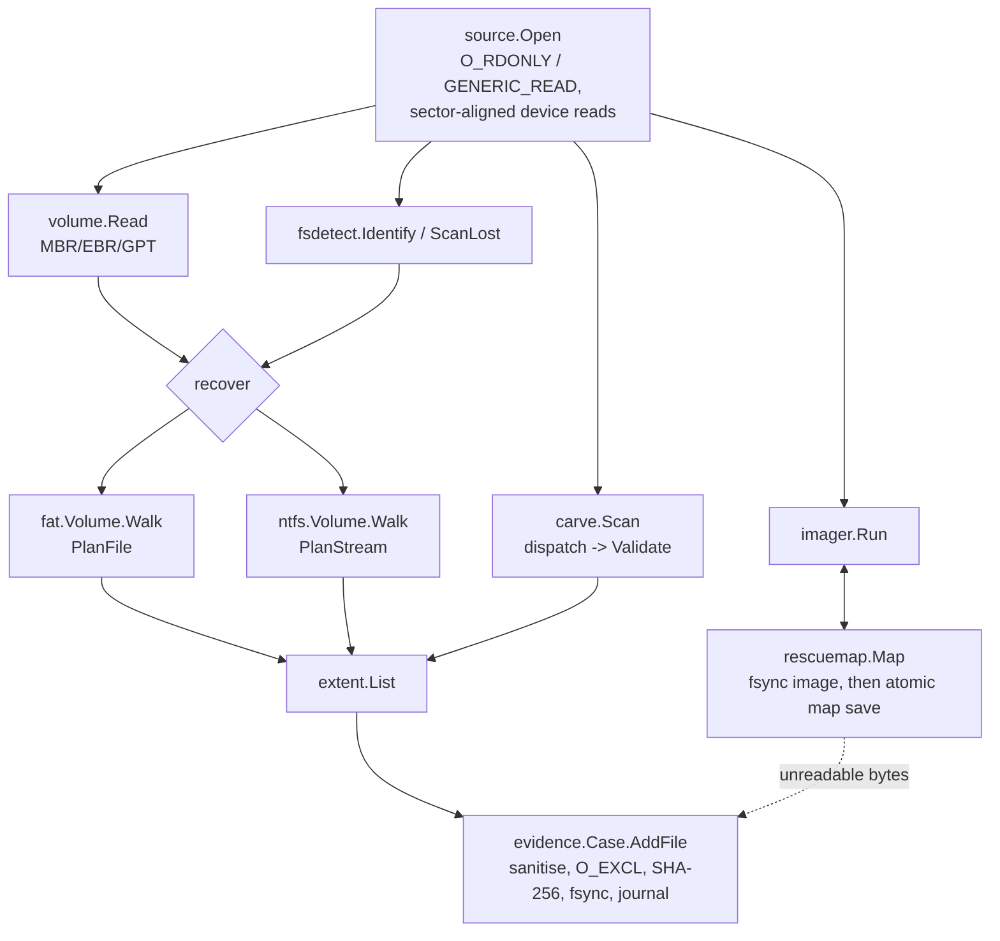

# Architecture

BareRelic is a layered pipeline. Each layer depends only on the ones below
it, and every layer that parses on-disk structures treats its input as
hostile.

```text
cmd/barerelic            process entry: signal handling -> cli.Run
internal/cli             commands, flags, exit codes, operator output
internal/evidence        case directory, hash-chained journal, manifest, verify, path sanitising
internal/imager          multi-phase rescue imaging over a rescue map
internal/rescuemap       GNU ddrescue-compatible interval map (atomic, durable saves)
internal/carve           signature dispatch + per-format structural validators
internal/fsdetect        file-system identification, lost-partition scan
internal/fs/fat          FAT12/16/32 reader, deleted-entry and orphan-directory recovery
internal/fs/ntfs         NTFS MFT reader, deleted-record and orphan-record recovery
internal/volume          MBR/EBR and GPT parsing
internal/extent          byte-range lists shared by every recovery path
internal/source          read-only sources: image files and raw devices
internal/testutil/...    fault-injecting disk, FAT and NTFS image builders (tests only)
```

## Data flow



Recovery is always split into **plan** and **read**: a file-system walker
turns metadata into an `extent.List` plus a confidence grade and notes, and
only then are bytes read. This keeps provenance exact (the extents are what
is journaled), lets `--dry-run` show everything without writing, and lets the
rescue map annotate any plan without the file-system code knowing about it.

## Key decisions

**Standard library only.** A recovery tool is often run on an unfamiliar or
air-gapped machine, sometimes as root against irreplaceable media. No third-
party code means a small, auditable trust base and trivially reproducible
static binaries (`CGO_ENABLED=0`).

**ddrescue's algorithm and mapfile format.** The phase strategy (copy with
exponential skipping, copy the skipped areas, trim, scrape, retry) is the
proven way to maximise data from dying drives, and the mapfile format lets
examiners use `ddrescueview`/`ddrescuelog` and switch tools mid-rescue.

**Durability ordering.** The image is fsynced *before* the map is saved, and
the map is saved by write-temp/fsync/rename. The map can therefore never
claim a byte is rescued unless it is on disk; a crash at any point resumes
correctly. Destination write errors are fatal and never mark data rescued.

**Validators, not magic numbers.** A carving signature only nominates a
candidate. Each format's validator walks its real structure — PNG chunk
CRCs, JPEG marker segments and entropy data, ZIP local/central directory
consistency, gzip CRC-32 after inflating, 7z header CRCs, OLE FAT tables,
SQLite header sizing, ISO-BMFF box walks, PE/ELF section tables — and
determines the exact length or rejects the candidate. This trades a little
recall on damaged files for far fewer junk results.

**Explicit confidence.** Recovery always involves inference. Instead of
presenting every result as equally real, each artifact carries a grade and
the reasons (e.g. "3 of 12 clusters are now allocated to other data").

**Bounded work on hostile input.** Nothing is allocated from a size field
alone: FAT tables, MFT tables and bitmaps are bounded by the bytes that
physically exist; FAT chains use Brent's cycle detection; directory reads
honour the FAT 65,536-entry limit; EBR chains, path resolution and directory
recursion have depth and loop guards. Every parser has a fuzz target.

**Streaming MFT walk.** The MFT is read twice — once to build a compact
directory tree (name, parent, sequence, flags), once to decode and emit files
— so memory scales with the number of records, not with their content.

**NTFS sequence-number semantics.** NTFS increments a record's sequence
number when it is freed, so a deleted child still refers to its deleted
parent's *previous* sequence. Path resolution accepts `seq` or `seq+1` for
free parents and marks anything else as `$OrphanFiles`, instead of silently
attaching files to whatever now occupies a reused record.

## Testing strategy

| Layer | Technique |
|---|---|
| rescuemap | randomised model-equivalence test against a byte-per-byte reference; ddrescue mapfile fixtures; fuzzed parser round-trip |
| imager | fault-injecting disk (permanent + flaky sectors, partial last sector), cancellation mid-run with resume from the persisted map, destination failure |
| volume / fsdetect | hand-built MBR/EBR (including loops), GPT at 512 and 4096-byte sectors, corrupted primary GPT, wiped MBR, lost volumes known only from backups |
| fs/fat, fs/ntfs | spec-derived image builders (`internal/testutil`) independent of the parsers; deleted, fragmented, reallocated, cyclic, quick-formatted, mirror/backup fallbacks, attribute lists, ADS, sparse and uninitialised data |
| carve | real files from Go's encoders (JPEG with embedded thumbnail, PNG, GIF, ZIP streamed and not, gzip) plus hand-built formats; damaged-file rejection; bad sectors during the scan |
| evidence | tamper detection: edited, deleted and truncated journal entries; modified artifacts; hostile file names |
| cli | end-to-end: synthetic MBR disk with FAT16 + NTFS partitions through image → verify → probe → recover → tamper → carve → rescue-map annotation; safety refusals and exit codes |
| all parsers | Go native fuzzing; crashers are committed under `testdata/fuzz` as regression seeds |
